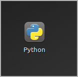

#  novelibre

*novelibre* helps novelists to plan extensive novels and to keep track of them
during creation and revision.

*novelibre* is designed for writers who are familiar with OpenOffice or LibreOffice. 

For more information, see the [novelibre home page](https://peter88213.github.io/novelibre-en/).

---

## Requirements

- Screen resolution of at least 900 pixels in height.
- Windows or Linux. Mac OS support is experimental, see [discussion](https://github.com/peter88213/novelibre/discussions/29).
- [Python](https://www.python.org/) version 3.7+. 
     - With **Windows 8-11**, use version 3.9.10 or above.
     - With **Vista and Windows 7**, use version 3.7.2.
     - **Linux** users: Make sure you have the tkinter support for Python 3 installed. 
       For Ubuntu, the package is called *python3-tk*, for Fedora it may be *python3-tkinter*.
- Either [LibreOffice](https://www.libreoffice.org/) or [OpenOffice](https://www.openoffice.org).

---

## Get the latest release

- [News](https://github.com/peter88213/novelibre/discussions/1?sort=new)
- [Changelog](docs/changelog.md)

### Download

#### Default: Executable Python zip archive

Download the latest release [novelibre_v5.68.2.pyz](https://github.com/peter88213/novelibre/raw/main/dist/novelibre_v5.68.2.pyz) (306 KB)

> [!IMPORTANT]
> Many web browsers recognize the download as an executable file and offer to open it immediately. 
> This starts the installation under Windows.
> 
> However, depending on your security settings, your browser may 
> initially  refuse  to download the executable file. 
> In this case, your confirmation or an additional action is required. 
> If this is not possible, you have the option of downloading 
> the zip file. 

#### Alternative: Zip file

The package is also available in zip format: 
[novelibre_v5.68.2.zip](https://github.com/peter88213/novelibre/raw/main/dist/novelibre_v5.68.2.zip) (307 KB)

### Strongly recommended

- You might want to install the 
  [nv_updater](https://github.com/peter88213/nv_updater/) 
  update checker and run it from time to time. 

### Translations

- [ Italian language package (to be completed)](https://github.com/peter88213/nv_it)
- [ French language package (to be completed)](https://github.com/peter88213/nv_fr)
- [ Spanish language package (to be completed)](https://github.com/peter88213/nv_es)

---

## Installation 

Be sure to read the installation instructions in the online user manual 
before you begin installation. 

- [Windows](https://peter88213.github.io/nvhelp-en/setup_windows.html)
- [Linux](https://peter88213.github.io/nvhelp-en/setup_linux.html)

### Python application launcher for Linux (optional)

Have your browser save this file either in your desktop folder or in your download folder:

[Python.desktop](https://github.com/peter88213/novelibre/raw/main/linux/Python.desktop)

Then you can drag/drop *.pyz* files onto this launcher to conveniently install *novelibre* and its plugins.

This is how the Python launcher looks on the Linux Mint desktop:

---

## Documentation

- [novelibre User guide](https://peter88213.github.io/nvhelp-en/) - Online manual in English.
- [novelibre Wiki](https://github.com/peter88213/novelibre/wiki) - Tutorials.
- [novelibre Benutzerhandbuch](https://peter88213.github.io/nvhelp-de/) - Online manual in German.
- [novelibre development kanban board](https://github.com/users/peter88213/projects/14) - Planned features and deveopment progress.

## Contact

- [novelibre discussions](https://github.com/peter88213/novelibre/discussions) - The right place to give feedback, ask questions, and make suggestions.
- [novelibre issues](https://github.com/peter88213/novelibre/issues) - The right place to report bugs.

---

## Credits

- The logos and file icons are made using the free *Pusab* font by Ryoichi Tsunekawa, [Flat-it](http://flat-it.com/).
- The icons are based on the [Eva Icons](https://akveo.github.io/eva-icons/#/), published under the [MIT License](http://www.opensource.org/licenses/mit-license.php). The original black and white icons were colored for this application by the maintainer. 
- The flag icons are from [Flaticon.com](https://www.flaticon.com/free-icons/flag).

## See also

### Plugins

[List of all plugins](docs/plugins.md)

### Utilities

- [scap_novx](https://github.com/peter88213/scap_novx/): A Python script for generating a novelibre project from a Scapple outline.
- [novx_xtg](https://github.com/peter88213/novx_xtg/): A Python script for exporting XPress tagged text from novelibre projects.
- [novx_html](https://github.com/peter88213/novx_html/): A template-based html exporter for novelibre.

### OpenOffice/LibreOffice extensions

*Writer* macros that may come in handy when editing your manuscript.

- [novelibre-tools](https://github.com/peter88213/novelibre-tools/):
  OpenOffice/LibreOffice extension for processing documents 
  in connection with *novelibre*.
- [StyleSwitcher](https://peter88213.github.io/StyleSwitcher/):
  Quickly switch between the style sheets of different document templates. 
- [curly](https://peter88213.github.io/curly/):
  Conversion of "curly quotes", 
  typographical apostrophes, ellipses and so on
  in several languages.
- [emph](https://peter88213.github.io/emph/):
  Use character styles instead of direct formatting to mark up text.

## License

This is Open Source software, and *novelibre* is licensed under GPLv3. See the
[GNU General Public License website](https://www.gnu.org/licenses/gpl-3.0.en.html) for more
details, or consult the [LICENSE](LICENSE) file.

